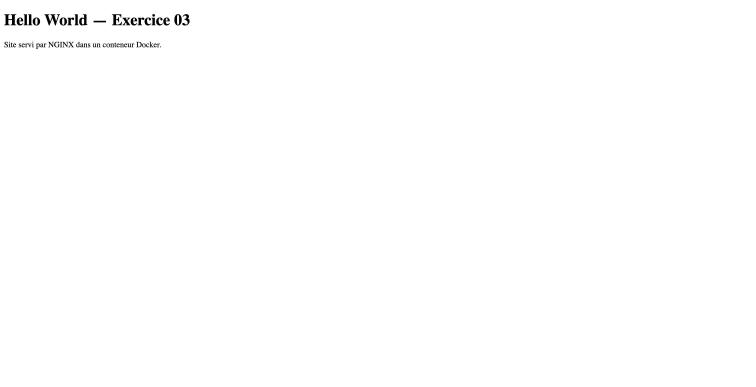

# Exercice Docker #3 - Site web personnalisé avec NGINX

**Objectif :** déployer un site web personnalisé servi par NGINX, accessible depuis l'hôte sur http://localhost:8080.

Fichiers : dossier `exo-03/`.

---

## 1. Page d'accueil personnalisée - `index.html`

```html
<!DOCTYPE html>
<html lang="fr">
<head>
  <meta charset="UTF-8">
  <title>Exercice 03</title>
</head>
<body>
  <h1>Hello World - Exercice 03</h1>
  <p>Site servi par NGINX dans un conteneur Docker.</p>
</body>
</html>
```

## 2. Dockerfile

```dockerfile
FROM nginx:alpine
COPY index.html /usr/share/nginx/html/index.html
EXPOSE 80
```

- `FROM nginx:alpine` : part de l'image officielle NGINX (version Alpine, légère)
- `COPY` : remplace la page par défaut de NGINX par notre page
- `EXPOSE 80` : indique le port d'écoute de NGINX dans le conteneur

## 3. Construire l'image

```bash
cd exo-03
docker build -t site-exercice-03 .
```

```
#5 [1/2] FROM docker.io/library/nginx:alpine@sha256:df221db8…
#6 [2/2] COPY index.html /usr/share/nginx/html/index.html
#6 DONE 0.1s
#7 naming to docker.io/library/site-exercice-03 done
```

```bash
docker images site-exercice-03
```

```
REPOSITORY         TAG       IMAGE ID       CREATED                  SIZE
site-exercice-03   latest    d163449e6d8e   Less than a second ago   62.4MB
```

## 4. Lancer le conteneur

```bash
docker run -d --name site-03 -p 8080:80 site-exercice-03
docker ps --filter name=site-03
```

```
NAMES     IMAGE              PORTS                  STATUS
site-03   site-exercice-03   0.0.0.0:8080->80/tcp   Up 2 seconds
```

## 5. Accéder au site

```bash
curl -s http://localhost:8080
```

```html
<!DOCTYPE html>
<html lang="fr">
<head>
  <meta charset="UTF-8">
  <title>Exercice 03</title>
</head>
<body>
  <h1>Hello World - Exercice 03</h1>
  <p>Site servi par NGINX dans un conteneur Docker.</p>
</body>
</html>
```

Dans le navigateur de l'hôte, sur http://localhost:8080 :



---

## Problème rencontré : 403 Forbidden

Au premier essai, NGINX répondait :

```
<head><title>403 Forbidden</title></head>
```

Le fichier `index.html` sur l'hôte avait les droits `-rw-------` (lisible seulement par son propriétaire). `COPY` conserve ces droits, et le processus NGINX (utilisateur `nginx`) ne pouvait donc pas lire la page. Correctif : rendre les fichiers lisibles, puis reconstruire l'image.

```bash
chmod -R go+rX .
docker build -t site-exercice-03 .
```

On peut aussi écrire `COPY --chmod=644 index.html /usr/share/nginx/html/index.html` dans le Dockerfile.

## Nettoyage

```bash
docker rm -f site-03
```
