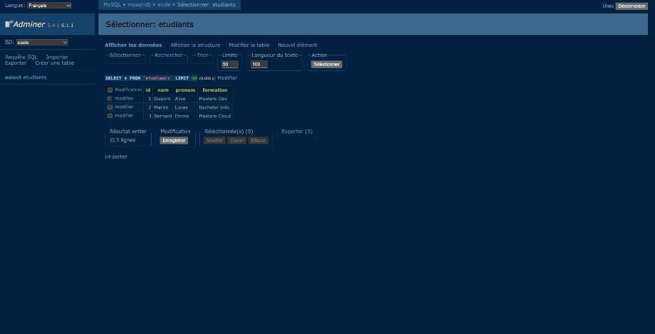

# Exercice Docker #5 - MySQL et Adminer

**Objectif :** déployer MySQL et Adminer dans deux conteneurs qui communiquent par leur nom, avec des données persistantes, un redémarrage automatique, et seul Adminer exposé sur l'hôte.

Fichiers : dossier `exo-05/`.

---

## 1. Créer le réseau et le volume

```bash
docker network create reseau-exo5
docker volume create mysql-data
```

## 2. Déployer le conteneur MySQL

```bash
docker run -d \
  --name mysql-db \
  --network reseau-exo5 \
  --restart unless-stopped \
  -v mysql-data:/var/lib/mysql \
  -e MYSQL_ROOT_PASSWORD=rootpass \
  -e MYSQL_DATABASE=ecole \
  -e MYSQL_USER=theo \
  -e MYSQL_PASSWORD=theopass \
  mysql:8.4
```

| Option | Rôle |
|---|---|
| `--network reseau-exo5` | communication avec Adminer par le nom `mysql-db` |
| `--restart unless-stopped` | redémarrage automatique (panne, redémarrage de Docker) |
| `-v mysql-data:/var/lib/mysql` | persistance des données |
| `MYSQL_DATABASE` / `MYSQL_USER` / `MYSQL_PASSWORD` | base et utilisateur dédiés |
| pas de `-p` | MySQL **n'est pas** accessible depuis l'hôte |

## 3. Déployer le conteneur Adminer

```bash
docker run -d \
  --name adminer \
  --network reseau-exo5 \
  --restart unless-stopped \
  -p 8080:8080 \
  adminer
```

```bash
docker ps --filter network=reseau-exo5
```

```
NAMES      IMAGE       PORTS                    STATUS
adminer    adminer     0.0.0.0:8080->8080/tcp   Up 2 seconds
mysql-db   mysql:8.4   3306/tcp, 33060/tcp      Up 10 seconds
```

Seul Adminer a un port publié (`0.0.0.0:8080->8080`). Les ports de MySQL restent internes au réseau Docker.

## 4. Se connecter à MySQL depuis Adminer

Sur http://localhost:8080 :

| Champ | Valeur |
|---|---|
| Système | MySQL / MariaDB |
| Serveur | `mysql-db` (nom du conteneur, pas d'IP) |
| Utilisateur | `theo` |
| Mot de passe | `theopass` |
| Base de données | `ecole` |


## 5. Créer une table et insérer des enregistrements

Dans Adminer → **Requête SQL** :

```sql
CREATE TABLE etudiants (
  id INT AUTO_INCREMENT PRIMARY KEY,
  nom VARCHAR(50) NOT NULL,
  prenom VARCHAR(50) NOT NULL,
  formation VARCHAR(50)
);

INSERT INTO etudiants (nom, prenom, formation) VALUES
  ('Dupont', 'Alice', 'Mastere Dev'),
  ('Martin', 'Lucas', 'Bachelor Info'),
  ('Bernard', 'Emma', 'Mastere Cloud');
```

Résultat dans Adminer : « Requête exécutée avec succès, 0 ligne modifiée », puis « …, 3 lignes modifiées ».

Consultation des enregistrements (table `etudiants` → **Afficher les données**) :



---

## Vérifications

### a) Persistance : supprimer puis recréer le conteneur MySQL

```bash
docker rm -f mysql-db
```

Recréation avec **le même volume** :

```bash
docker run -d --name mysql-db --network reseau-exo5 --restart unless-stopped \
  -v mysql-data:/var/lib/mysql \
  -e MYSQL_ROOT_PASSWORD=rootpass -e MYSQL_DATABASE=ecole \
  -e MYSQL_USER=theo -e MYSQL_PASSWORD=theopass \
  mysql:8.4

docker exec mysql-db mysql -utheo -ptheopass ecole -e "SELECT * FROM etudiants;"
```

```
id	nom	prenom	formation
1	Dupont	Alice	Mastere Dev
2	Martin	Lucas	Bachelor Info
3	Bernard	Emma	Mastere Cloud
```

La table et ses 3 lignes sont toujours là : les données vivent dans le volume `mysql-data`, pas dans le conteneur.

### b) Redémarrage automatique : simuler une panne

On arrête le processus principal de MySQL (PID 1) depuis l'intérieur du conteneur. Ce n'est pas un `docker stop` volontaire, donc la politique de redémarrage s'applique.

```bash
docker inspect -f 'Redémarrages : {{.RestartCount}}' mysql-db
```

```
Redémarrages : 0
```

```bash
docker exec mysql-db bash -c 'kill 1'
```

Quelques secondes plus tard :

```bash
docker ps --filter name=mysql-db
docker inspect -f 'Redémarrages : {{.RestartCount}}' mysql-db
```

```
NAMES      STATUS
mysql-db   Up 2 seconds
Redémarrages : 1
```

Docker a relancé le conteneur tout seul, et les données sont intactes :

```bash
docker exec mysql-db mysql -utheo -ptheopass ecole -e "SELECT COUNT(*) AS nb FROM etudiants;"
```

```
nb
3
```

> `docker exec mysql-db kill 1` ne marche pas : l'image `mysql` ne contient pas l'exécutable `kill` (« executable file not found in $PATH »). D'où `bash -c 'kill 1'`, qui utilise la commande intégrée de bash.
> Un `docker stop` ne déclencherait pas de redémarrage : Docker le considère comme un arrêt volontaire.

### c) MySQL n'est pas exposé sur l'hôte

```bash
docker port mysql-db
docker port adminer
```

```
8080/tcp -> 0.0.0.0:8080
```

`docker port mysql-db` ne renvoie rien. Seul Adminer est publié.

---

## Bonus : `compose.yaml`

```yaml
services:
  mysql-db:
    image: mysql:8.4
    restart: unless-stopped
    environment:
      MYSQL_ROOT_PASSWORD: rootpass
      MYSQL_DATABASE: ecole
      MYSQL_USER: theo
      MYSQL_PASSWORD: theopass
    volumes:
      - mysql-data:/var/lib/mysql
    networks:
      - reseau-exo5

  adminer:
    image: adminer
    restart: unless-stopped
    ports:
      - "8080:8080"
    depends_on:
      - mysql-db
    networks:
      - reseau-exo5

volumes:
  mysql-data:

networks:
  reseau-exo5:
```

On supprime d'abord les conteneurs créés à la main (conflit de port 8080), puis on démarre les deux services en une commande :

```bash
docker rm -f mysql-db adminer
cd exo-05
docker compose up -d
```

```
 Network exo-05_reseau-exo5  Created
 Volume "exo-05_mysql-data"  Created
 Container exo-05-mysql-db-1  Started
 Container exo-05-adminer-1  Started
```

```bash
docker compose ps
```

```
NAME                IMAGE       COMMAND                  SERVICE    CREATED                  STATUS                  PORTS
exo-05-adminer-1    adminer     "entrypoint.sh docke…"   adminer    Less than a second ago   Up Less than a second   0.0.0.0:8080->8080/tcp
exo-05-mysql-db-1   mysql:8.4   "docker-entrypoint.s…"   mysql-db   Less than a second ago   Up Less than a second   3306/tcp, 33060/tcp
```

```bash
docker compose exec mysql-db mysql -utheo -ptheopass ecole -e "SELECT DATABASE();"
```

```
DATABASE()
ecole
```

Arrêt :

```bash
docker compose down        # conserve le volume
docker compose down -v     # supprime aussi le volume (données perdues)
```

> Compose préfixe les ressources par le nom du dossier (`exo-05_mysql-data`, `exo-05_reseau-exo5`). Ce sont donc des ressources distinctes de celles créées à la main.
