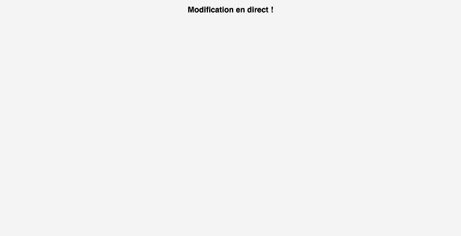

# Exercice Docker #6 - Conteneur de développement NGINX avec volume

**Objectif :** coder un site web dans un dossier de l'ordinateur hôte et le voir servi en direct par NGINX dans un conteneur, sans rien installer en local.

Fichiers : dossier `exo-06/` (le site est dans `exo-06/site/`).

---

## 1. Le site sur l'hôte

`site/index.html` :

```html
<!DOCTYPE html>
<html lang="fr">
<head>
  <meta charset="UTF-8">
  <title>Exercice 06</title>
  <link rel="stylesheet" href="style.css">
</head>
<body>
  <h1>Site en développement - Exercice 06</h1>
</body>
</html>
```

`site/style.css` :

```css
body { font-family: sans-serif; background: #f4f4f4; text-align: center; }
```

## 2. Lancer NGINX avec un volume (bind mount)

```bash
cd exo-06
docker run -d \
  --name nginx-dev \
  -p 8080:80 \
  -v "$(pwd)/site":/usr/share/nginx/html \
  nginx:alpine
```

| Option | Rôle |
|---|---|
| `-v "$(pwd)/site":/usr/share/nginx/html` | monte le dossier `site` de l'hôte à la place du dossier web de NGINX |
| `-p 8080:80` | site accessible sur http://localhost:8080 |
| `nginx:alpine` | image officielle NGINX, rien à installer sur l'hôte |

> `-v` attend un chemin absolu pour un dossier de l'hôte, d'où `$(pwd)`.

Vérifier le montage :

```bash
docker inspect -f '{{range .Mounts}}{{.Type}} : {{.Source}} -> {{.Destination}}{{end}}' nginx-dev
```

```
bind : /Users/theosauval/Desktop/exercices-docker/exo-06/site -> /usr/share/nginx/html
```

## 3. Tester

```bash
curl -s http://localhost:8080 | grep '<h1>'
```

```
  <h1>Site en développement - Exercice 06</h1>
```

## 4. Développer en direct

On modifie `site/index.html` **sur l'hôte**, sans toucher au conteneur. Ici, avec `sed` (on peut aussi éditer le fichier dans VS Code et enregistrer) :

```bash
sed -i '' 's|<h1>.*</h1>|<h1>Modification en direct !</h1>|' site/index.html
curl -s http://localhost:8080 | grep '<h1>'
```

```
  <h1>Modification en direct !</h1>
```

La modification est visible immédiatement, sans rebuild ni redémarrage du conteneur. Les fichiers ne sont pas copiés : le conteneur lit directement le dossier de l'hôte.

```bash
docker exec nginx-dev ls /usr/share/nginx/html
```

```
index.html
style.css
```

Dans le navigateur, après rafraîchissement (le CSS est bien appliqué) :



---

## Variante : montage en lecture seule

Pour empêcher le conteneur de modifier les fichiers de l'hôte :

```bash
docker run -d --name nginx-dev -p 8080:80 \
  -v "$(pwd)/site":/usr/share/nginx/html:ro \
  nginx:alpine
```

## Nettoyage

```bash
docker rm -f nginx-dev
```

Le dossier `site` et son contenu restent sur l'hôte.
